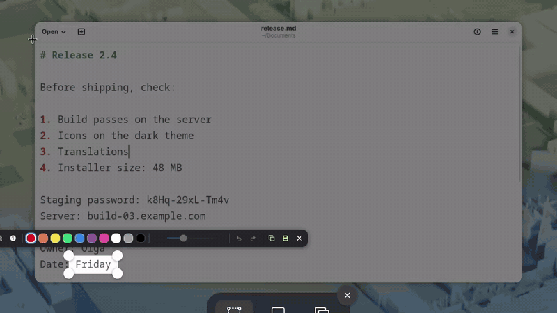
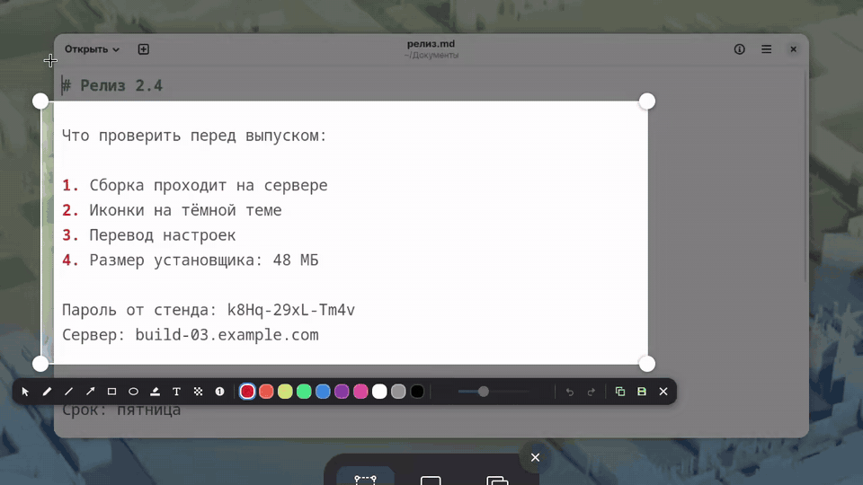
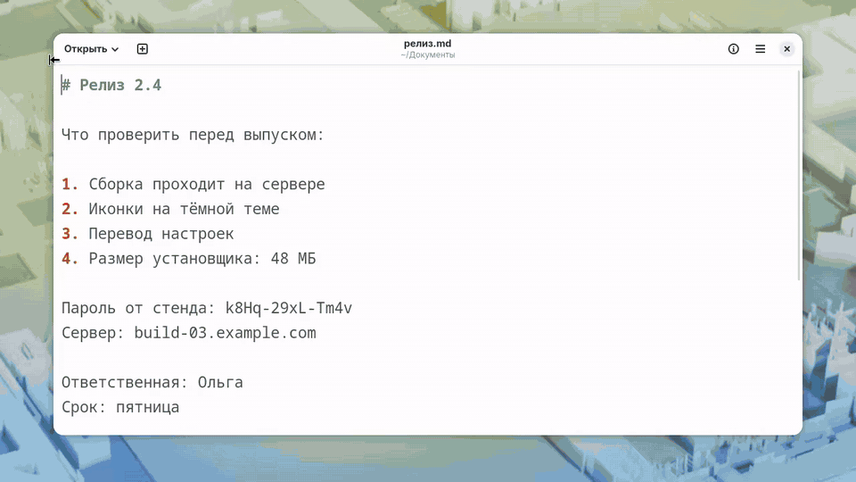
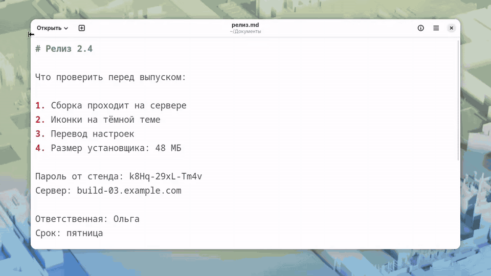
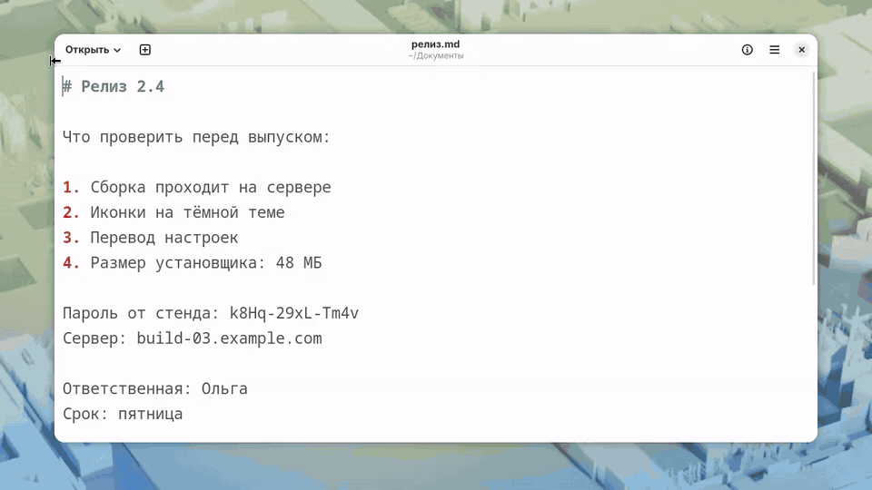
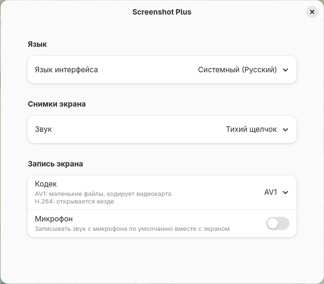

# Screenshot Plus

**English** · [Русский](README.ru.md)

A GNOME Shell 50–51 extension that adds Flameshot-style drawing to the built-in
screenshot tool, and records the screen to AV1 on the GPU. `Print` still opens the
same native screenshot UI, now with a toolbar.



Everything in one minute. The same as a video: [overview-en.mp4](docs/overview-en.mp4)
(AV1, recorded by the extension itself, 740 KB). The demos for each part below show the
interface in Russian; it follows the system language, see [Settings](#settings).

## Drawing



- Pen, line, arrow, rectangle, ellipse, highlighter, text, pixelate and numbers.
- Ten colours. Width is set with a slider or the mouse wheel, and every tool keeps its
  own: a thin pen and a thick highlighter do not overwrite each other.
- A rectangle or an ellipse can be filled with its colour: the bucket button or `F`.
  Each of the two remembers whether it fills.
- A click places a number; drag instead and it gets an arrow. Numbering runs across
  all of them.
- Line and arrow: drag for a straight one, or click point by point for a broken one.
  A double-click, `Enter` or the right button ends it, `Backspace` takes back the
  last point, `Esc` drops it. A broken arrow has its head on the last point. Each
  point has its own handle afterwards.
- Pixelate hides passwords and anything else that must not end up in the picture. The
  file holds only the blocks there, none of the original pixels.
- `Shift` while drawing gives exact 45° steps and squares.
- Copy and save are separate. The window closes the moment you press either, and the
  image is finished in the background. If saving fails, the image is left on the
  clipboard and a notification says so.
- Instead of the loud shutter you get a short soft click, also for screenshots taken
  with GNOME's own shortcuts. This can be changed in the settings.

## Text



- Letter colour, outline and background are set separately, the background also with
  its opacity, height and width.
- Two handles on the sides. While you drag one, the other stays put, and the text turns
  and scales around it, smoothly and without jumps. With `Shift` the angle moves in 15°
  steps, and it snaps near level.
- The handle on top moves the text.
- Double-click edits it. Turned text stays turned and new letters run along it. Pasting
  from the clipboard works.

## Editing what is drawn



The select tool (`0`) picks up any shape. Drag it, pull its handles, recolour it,
change its width with the wheel, remove it with `Delete`. A number with an arrow has
parts: the circle moves on its own and the arrow keeps pointing at the same spot, the
tip moves on its own too, and dragging the arrow itself moves everything. `Ctrl+Z`
undoes any of it.

Over the selected shape, and over text while it is typed, a small panel holds what
that shape has: colours, width, fill for a rectangle or an ellipse, letter size,
outline and background for text, and a delete button. The bar keeps the same
controls for the tool.

## Selection



- With any tool, pressing outside the selection starts a new one, and its corners and
  edges resize it as they do without a tool. The pointer changes, and a label next to
  it says which will happen: "New selection" or "Resize selection".
- A stray click outside does not throw the selection away.
- While you drag out or resize the selection, a magnifier next to the pointer shows the
  screenshot's pixels under it up close, every physical pixel a square of its own, and
  the size of the selection in the pixels of the picture you will get. It can be turned
  off in the settings.
- Drawings stay when the selection changes: whatever ends up outside is dimmed along
  with the screen. Only what is inside goes into the picture.
- The selection can span both monitors, as in the native UI. The toolbar sits on the
  monitor that holds most of the selection.

## Keys

| Key | Action |
|---|---|
| `1`–`9` | pen, line, arrow, rectangle, ellipse, highlighter, text, pixelate, number |
| `0` | select: pick up what is already drawn |
| `Ctrl+C` | copy only |
| `Ctrl+S` | save only |
| `Enter` or the round button | save and copy |
| `Ctrl+Z`, `Ctrl+Shift+Z` | undo, redo |
| `F` | fill the rectangle or ellipse, or stop filling it |
| `Delete` | delete the selected shape |
| `Esc` | deselect, then close |
| mouse wheel | width, text size |
| `Shift` while drawing | exact 45° and squares |
| `Enter`, `Backspace`, `Esc` on a broken line | end it, take back a point, drop it |

Shortcuts are bound to physical keys, so they work with any keyboard layout.

## Settings



Open them from the Extensions app, or with
`gnome-extensions prefs screenshot-plus@maksym`.

- **Language.** The system language by default, or English when there is no
  translation for it. Available: English, Russian, Ukrainian, German, French, Spanish,
  Portuguese, Italian, Polish, Norwegian Bokmål, Turkish, Japanese, Simplified Chinese
  and Esperanto. Translations other than English and Russian were written without a
  native speaker, so corrections are welcome: the strings are in `translations.js`.
- **Screenshot sound.** Soft click, GNOME's shutter, or none.
- **Tools around the selection.** Off by default: one bar under the selection. On:
  the tools, the colours and the undo, copy and save buttons spread over the edges of
  the selection, like Flameshot's buttons. Along the bottom edge first, as many as fit
  there, the rest on the right, the top and the left; on the sides the tools and the
  buttons stand in a column. A small selection gets them on the next round, further
  from its edge, and one that fills the screen gets them inside, in a row above the
  native panel.
- **Magnifier.** On by default: see [Selection](#selection).
- **Recording codec.** AV1 or H.264.
- **Microphone.** Records sound from a microphone along with the screen, and which one:
  the default or any connected microphone. The list follows headsets being plugged in.
- **Show clicks.** On by default; see [Recording](#recording).

## Recording

The codec is chosen in the settings or with the `AV1`/`H.264` button in recording
mode. `H.264` is GNOME's own recorder, for when compatibility matters.

The microphone button next to it (and the same switch in the settings) adds sound
from a microphone, cleaned up for voice the way video calls do it: noise suppression,
a cut of low hum, and a gentle automatic gain of up to +20 dB for quiet laptop
microphones, with a limiter against loud peaks. It is stored as mono AAC at
128 kbit/s, which every player handles and which barely adds to the file. Inputs
with nothing plugged in, such as an empty headset jack, are left out of the lists. The small arrow beside the button lists the microphones, so the right
one can be picked just before recording, and picking one turns sound on. The tooltip
of the button says which one is in use. If the chosen microphone is unplugged, the
default one records instead, with a notification. GNOME's recorder cannot record sound, so H.264 with the
microphone goes through this extension's recorder as well, on NVENC or else on the
CPU. If the microphone cannot be opened, the recording goes on without sound and a
notification says so.

While an area records, the rest of the screen is not dimmed as GNOME does; a thin
red frame just outside the area marks it and never gets into the video.

With "Show Pointer" on, every click gets a circle around the pointer, so viewers see
where you clicked: yellow for the left button, blue for the right, green for the
middle. A held button keeps its circle under the pointer, which shows drags, and
letting go makes it spread out and fade. The circles are drawn on the screen itself,
so you see them too. They can be turned off in the settings.

When a recording ends, its notification stays in the list until dismissed: click it
to watch the video, or "Show in Files" opens the folder with the video selected.

For AV1 the recorder takes the first path that fits:

1. `amd-av1-dmabuf`: the AMD encoder with no frame copies. Only when the width is a
   multiple of 64 and the height of 16, otherwise it adds black bars (1920×1080
   becomes 1920×1082).
2. `nvenc-av1`: NVENC, with frames going through system memory. Sides from 200 pixels.
3. GNOME's own recorder: on any start-up failure, and for very small areas.

The recorder runs as a separate process (`recorder.js`), so if it crashes, the shell
does not. The path in use is written to the journal:
`journalctl --user -b -g 'screenshot-plus'`.

## Privacy and safety

- Nothing leaves the computer: no network access, telemetry or downloads. Recording
  goes from Mutter's screen cast API through PipeWire on this machine into a file.
- The extension stays enabled while the screen is locked, so a recording in progress
  keeps going. It starts nothing there: drawing is off on the lock screen, and only
  what GNOME's own screenshot UI allows there can be done.
- Pixelate: the saved image holds only the blocks. While the on-screen preview is
  made, the selected area is written for a moment to a private file in
  `$XDG_RUNTIME_DIR/screenshot-plus-tmp`, which is in memory, and deleted right away.
  Anything left there after a crash is removed at the next start.
- When an app asks for a screenshot, the app always gets the file, whichever button
  was used. The image goes to the clipboard only with copy or `Enter`.
- The microphone is recorded only while its toggle is on.
- `tests/driver.js` lets any code run in the shell over D-Bus. It is not installed by
  the steps below and stays off unless started by `tests/session.sh` in its own
  throwaway shell. `tests/session.sh` wipes its work folder before each run and
  refuses to wipe a folder it did not create.

## Install and remove

```sh
git clone https://github.com/Noxam98/screenshot-plus ~/src/screenshot-plus
ln -s ~/src/screenshot-plus ~/.local/share/gnome-shell/extensions/screenshot-plus@maksym
glib-compile-schemas ~/src/screenshot-plus/schemas
gnome-extensions enable screenshot-plus@maksym   # after logging in again
```

To turn it off: `gnome-extensions disable screenshot-plus@maksym`.

## Applying code changes

Run `./reload.sh`, no new login needed. GNOME caches modules by path for the whole
session, so `extension.js` copies the code to a new folder under
`$XDG_RUNTIME_DIR/screenshot-plus` on every enable and runs it from there. A new login
is needed only when `extension.js` or `metadata.json` themselves change.

## Tests

`tests/session.sh` starts a separate GNOME Shell with no screen and its own `HOME`,
dconf and D-Bus, so the real session is left alone. `tests/ctl.sh` drives it and sends
input, `tests/stop.sh` stops it. `gjs -m tests/shapes-test.js` checks the geometry of
the shapes, `gjs -m tests/layout-test.js` the placement of the tools around the selection.

## License

GPL-2.0-or-later, like GNOME Shell itself. The text is in `LICENSE`.
