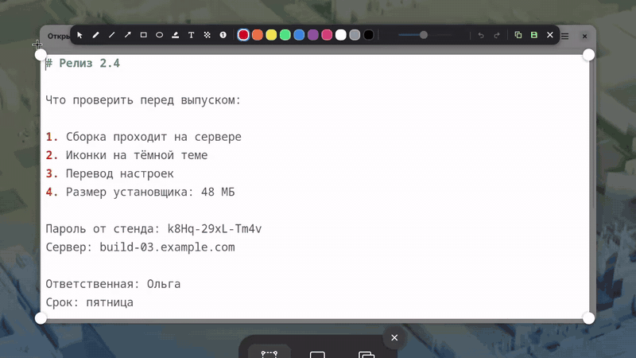
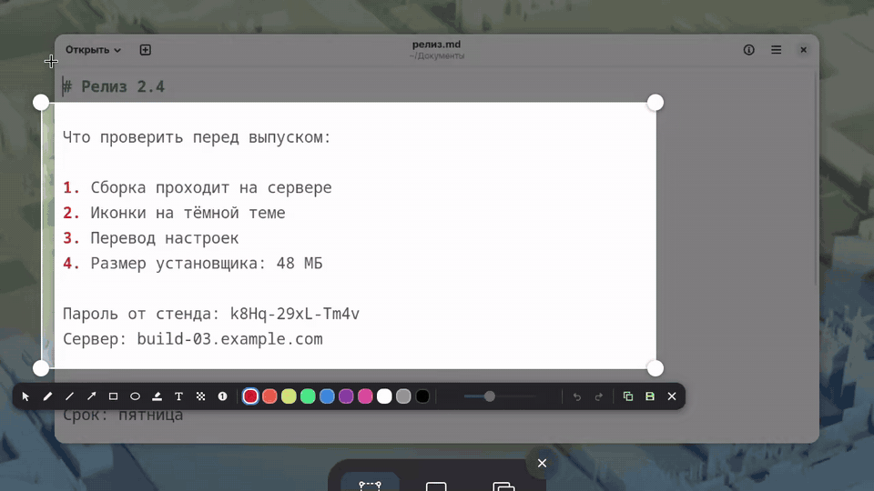
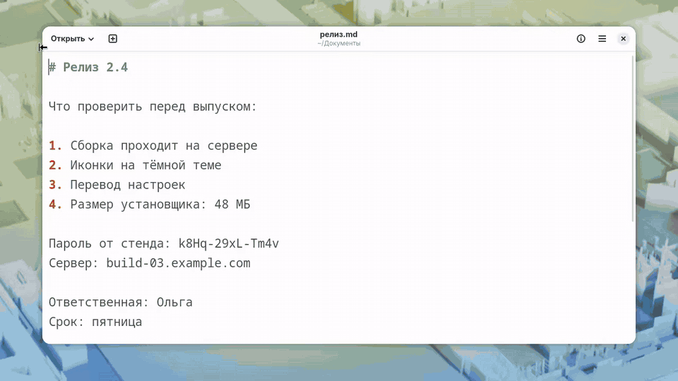
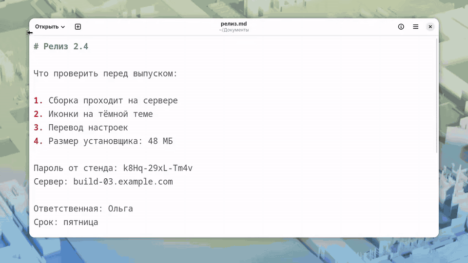
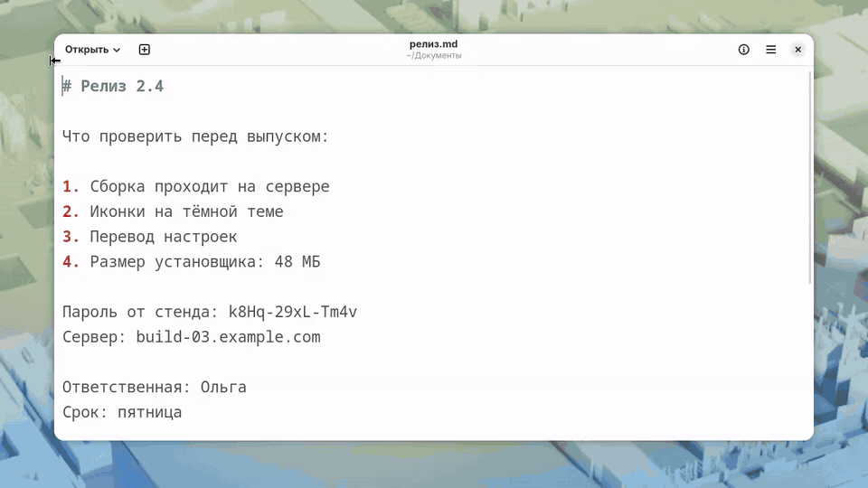
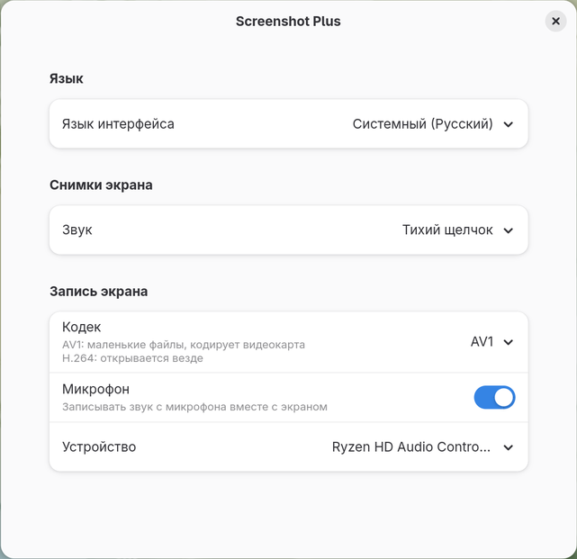

# Screenshot Plus

[English](README.md) · **Русский**

Расширение GNOME Shell 50: рисование поверх родного скриншотера в стиле Flameshot
и запись экрана в AV1 на видеокарте. Родное окно по `Print` остаётся тем же, к нему
добавляется панель инструментов.



Всё за минуту. То же видеофайлом: [overview-ru.mp4](docs/overview-ru.mp4) (AV1,
записано самим расширением, 770 КБ).

## Рисование



- Карандаш, линия, стрелка, прямоугольник, эллипс, маркер, текст, пиксели и цифры.
- Десять цветов. Толщина задаётся ползунком или колесом мыши, и у каждого инструмента
  она своя: тонкий карандаш и толстый маркер не сбивают друг друга.
- Цифра ставится щелчком, а если протянуть, от неё идёт стрелка. Нумерация общая.
- Пиксели закрывают пароли и прочее, что не должно попасть в снимок. В файле на этом
  месте только блоки, исходных пикселей там нет.
- `Shift` при рисовании даёт ровно 45° и квадрат.
- Копировать и сохранить можно по отдельности. Окно закрывается в момент нажатия, а
  снимок дописывается в фоне. Если сохранить не удалось, снимок остаётся в буфере
  обмена, и приходит уведомление.
- Вместо громкого затвора звучит короткий тихий щелчок, и у снимков по сочетаниям
  самого GNOME тоже. Это меняется в настройках.

## Текст



- Отдельно настраиваются цвет букв, обводка и фон, у фона ещё плотность, высота и
  ширина.
- По бокам две ручки. Пока тянешь одну, вторая стоит на месте, а текст
  поворачивается и масштабируется вокруг неё, плавно и без скачков. С `Shift` угол идёт
  шагами по 15°, возле прямого положения прилипает.
- Ручка сверху перемещает надпись.
- Двойной щелчок правит текст. Повёрнутый остаётся повёрнутым, новые буквы идут вдоль
  него. Вставка из буфера работает.

## Правка нарисованного



Инструмент выбора (`0`) берёт любую фигуру. Её можно таскать, тянуть за ручки,
перекрашивать, менять толщину колесом, удалять клавишей `Delete`. У цифры со стрелкой
кружок двигается отдельно, и стрелка продолжает указывать туда же, остриё тоже
двигается отдельно, а за саму стрелку двигается всё вместе. Всё отменяется `Ctrl+Z`.

## Выделение



- С любым инструментом нажатие за пределами поля выделяет его заново, а углы и края
  поля тянутся как без инструмента. Курсор меняется, и рядом с ним написано, что будет:
  «Новое выделение» или «Размер выделения».
- Случайный щелчок мимо поля его не сбрасывает.
- Нарисованное не пропадает, когда поле меняется: всё, что оказалось снаружи,
  приглушено вместе с экраном. В снимок попадает только то, что внутри.
- Выделение может идти через оба монитора, как в родном окне. Панель встаёт на тот
  монитор, где выделения больше.

## Клавиши

| Клавиша | Действие |
|---|---|
| `1`–`9` | карандаш, линия, стрелка, прямоугольник, эллипс, маркер, текст, пиксели, цифра |
| `0` | выбор: взять уже нарисованное |
| `Ctrl+C` | только копировать |
| `Ctrl+S` | только сохранить |
| `Enter` или круглая кнопка | сохранить и скопировать |
| `Ctrl+Z`, `Ctrl+Shift+Z` | отменить, вернуть |
| `Delete` | удалить выбранное |
| `Esc` | снять выделение, затем закрыть |
| колесо | толщина, размер текста |
| `Shift` при рисовании | ровно под 45° и квадратом |

Сочетания привязаны к физическим клавишам, поэтому работают в любой раскладке.

## Настройки



Открываются из приложения «Расширения» или командой
`gnome-extensions prefs screenshot-plus@maksym`.

- **Язык.** По умолчанию язык системы, а если перевода на него нет, английский.
  Есть English, русский, українська, Deutsch, français, español, português, italiano,
  polski, norsk bokmål, Türkçe, 日本語, 简体中文 и эсперанто. Переводы, кроме русского и
  английского, сделаны без носителей языка, исправления приветствуются: строки лежат
  в `translations.js`.
- **Звук снимка.** Тихий щелчок, затвор GNOME или без звука.
- **Кодек записи.** AV1 или H.264.
- **Микрофон.** Записывать звук с микрофона вместе с экраном, и с какого: по умолчанию
  или с любого подключённого. Список обновляется, когда подключают гарнитуру.

## Запись

Кодек выбирается в настройках или кнопкой `AV1`/`H.264` в режиме записи. `H.264` это
родной рекордер GNOME, когда важна совместимость.

Кнопка с микрофоном рядом (и такой же переключатель в настройках) добавляет звук с
микрофона: моно AAC 96 кбит/с, его открывает любой плеер, а файл от него почти не
растёт. Маленькая стрелка рядом с кнопкой открывает список микрофонов, чтобы выбрать
нужный прямо перед записью, и выбор сразу включает звук. Во всплывающей подсказке
кнопки видно, какой микрофон выбран. Если выбранный отключён, запись идёт с микрофона
по умолчанию, и об этом приходит уведомление. Родной рекордер GNOME звук писать не умеет, поэтому H.264 с микрофоном
тоже пишет рекордер расширения, на NVENC, а без него на процессоре. Если микрофон не
открылся, запись идёт без звука, и об этом приходит уведомление.

Для AV1 рекордер выбирает первый подходящий путь:

1. `amd-av1-dmabuf`: кодер AMD без копирования кадров. Только если ширина кратна 64,
   а высота 16, иначе он добавляет чёрные поля (1920×1080 станет 1920×1082).
2. `nvenc-av1`: NVENC, кадры идут через оперативную память. Сторона от 200 пикселей.
3. Родной рекордер GNOME: при любом сбое запуска и для совсем маленьких областей.

Рекордер работает отдельным процессом (`recorder.js`), поэтому его падение не роняет
оболочку. Используемый путь пишется в журнал:
`journalctl --user -b -g 'screenshot-plus'`.

## Установка и откат

```sh
git clone https://github.com/Noxam98/screenshot-plus ~/src/screenshot-plus
ln -s ~/src/screenshot-plus ~/.local/share/gnome-shell/extensions/screenshot-plus@maksym
glib-compile-schemas ~/src/screenshot-plus/schemas
gnome-extensions enable screenshot-plus@maksym   # после перезахода в сеанс
```

Выключить: `gnome-extensions disable screenshot-plus@maksym`.

## Применить изменения кода

`./reload.sh`, без перезахода в сеанс. GNOME кеширует модули по пути на весь сеанс,
поэтому `extension.js` при каждом включении копирует код в новую папку в
`$XDG_RUNTIME_DIR/screenshot-plus` и запускает его оттуда. Перезаход нужен, только
если менялись сам `extension.js` или `metadata.json`.

## Тесты

`tests/session.sh` поднимает отдельную GNOME Shell без экрана со своими `HOME`, dconf
и D-Bus, реальный сеанс она не трогает. `tests/ctl.sh` управляет ею и шлёт ввод,
`tests/stop.sh` останавливает. `gjs -m tests/shapes-test.js` проверяет геометрию.

## Лицензия

GPL-2.0-or-later, как у самой GNOME Shell. Текст в `LICENSE`.
